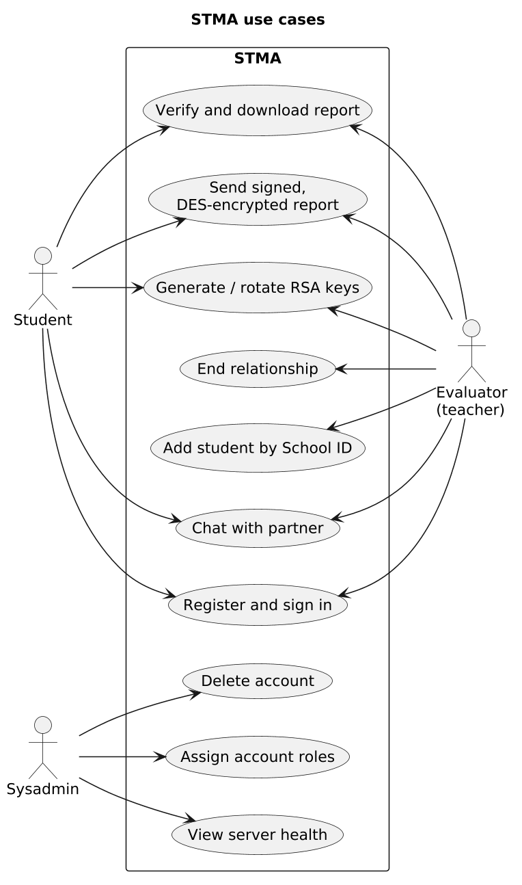
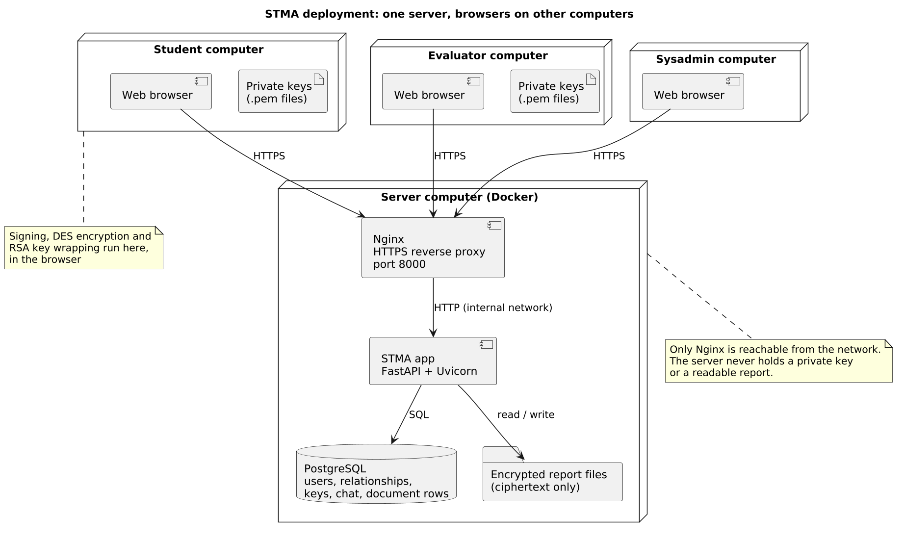
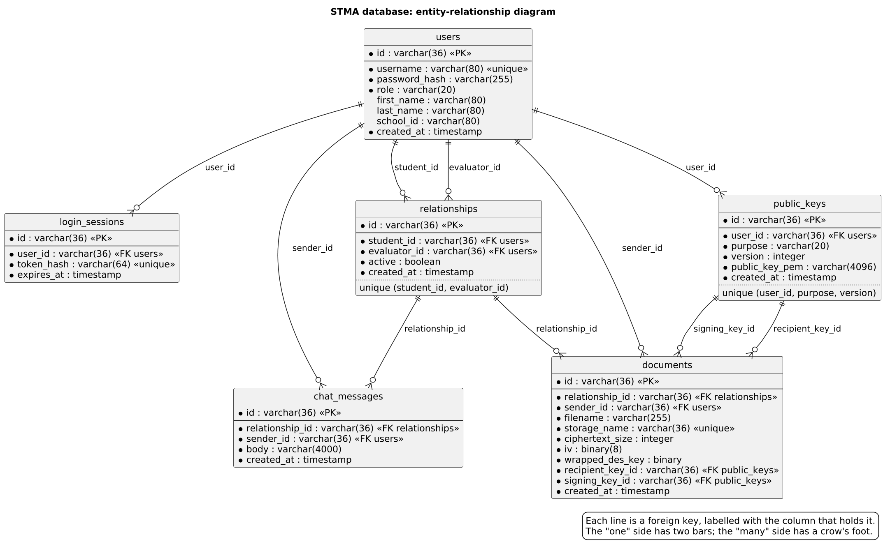
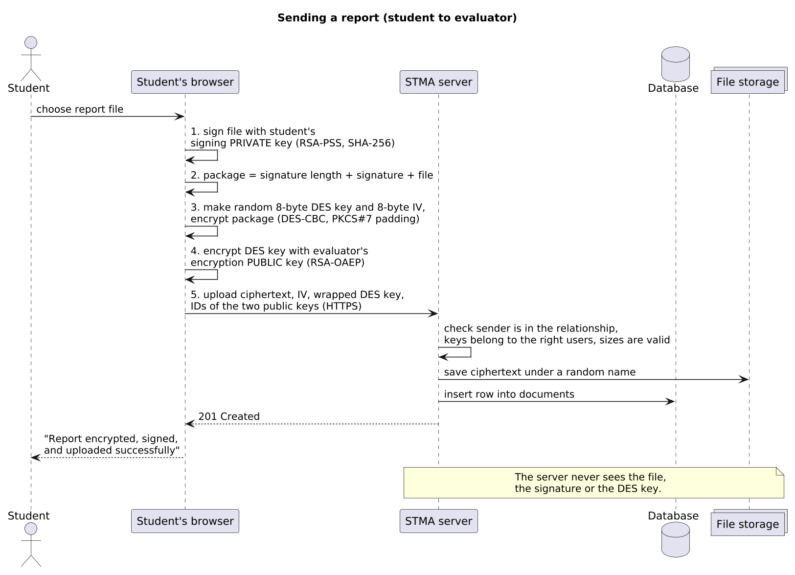
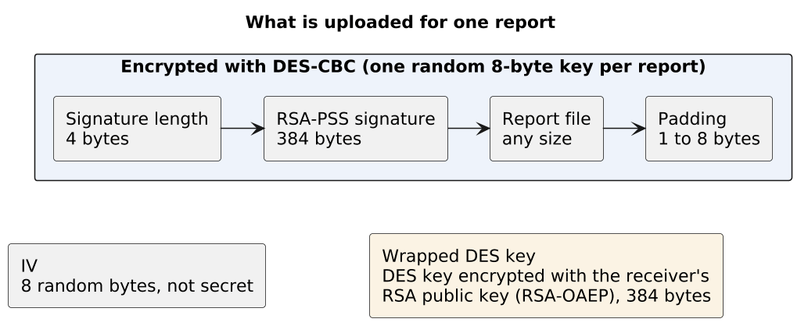
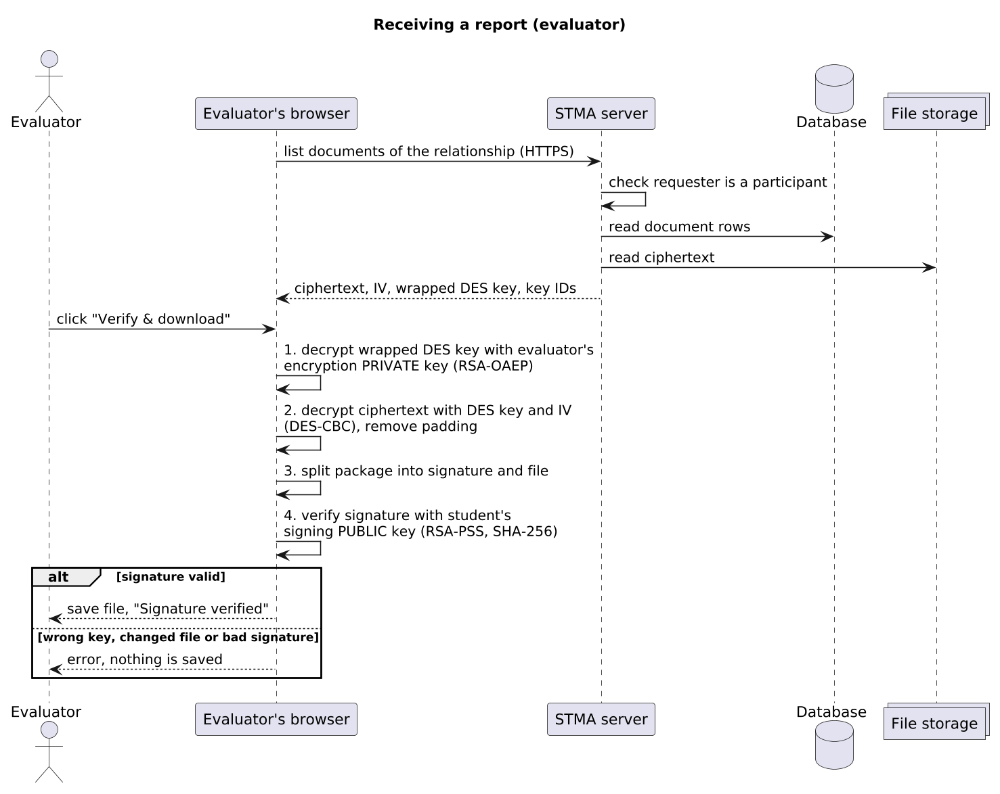

# STMA Study Guide

Nov 16, 2026 · @Utku

## Start here

STMA is a website where a student and a teacher (the "evaluator") chat and send each other report files, and the server that stores those files cannot read them.

That last part is the whole point of the project. A report is locked on the sender's computer before it is uploaded. Only the person it was sent to can unlock it. The server only ever holds a locked box.

If you remember one sentence for the defense, use this one:

> The sender signs the report with RSA, encrypts it with a fresh DES key, and locks that DES key with the receiver's RSA public key. The server stores only the encrypted result.

How to use this guide:

1. Read sections 2 to 4 once, slowly. They need no code.
2. Open the project in VS Code and follow sections 5 and 6 with the files open next to you.
3. Practise the questions in section 10 out loud. Cover the answer, say yours, then compare.
4. Read section 9 last. It lists where the project does less than the assignment text says, so a question about it does not surprise you.

Words used throughout: **plaintext** is the readable file, **ciphertext** is the locked, unreadable version, **encrypt** means lock, **decrypt** means unlock.

## The big picture

There is one server and many browsers. All encryption happens in the browser; the server only stores and forwards.

### Who uses it

| Role | What they can do | What they cannot do |
| --- | --- | --- |
| Student | Chat with their teacher, send and receive reports, create their own keys | See any conversation they are not part of |
| Evaluator (teacher) | Add a student by School ID, chat, send and receive reports, end a relationship | See another teacher's students |
| Sysadmin | See server health counts, give new accounts a role, delete accounts | Open any chat or document. The server answers 404 if they try |

A new account starts with the role `pending` and cannot log in until the Sysadmin makes it a student or an evaluator.



### The computers

The demo needs at least two computers: one runs the server, the others only need a web browser.

The server computer runs three Docker containers:

1. **Nginx** is the front door. It is the only container reachable from the network (port 8000) and it provides HTTPS.
2. **The app** is the Python program (FastAPI). It checks logins and permissions, and reads and writes the database.
3. **PostgreSQL** is the database. It is not reachable from outside.



Encrypted report files are saved in a folder on the server, not inside the database. The database only keeps a row describing each file.

### What the server can and cannot see

| Thing | Can the server read it? |
| --- | --- |
| Report contents | No. It only receives ciphertext |
| The DES key of a report | No. It only receives the key already locked with RSA |
| Private RSA keys | No. They never leave the user's computer |
| Public RSA keys | Yes. Public keys are meant to be public |
| Report file name, size, sender, date | Yes |
| Chat messages | Yes. Chat is protected by HTTPS on the network but stored as normal text in the database |
| Passwords | No. Only a one-way hash is stored |

Be ready for the chat row. The assignment requires DES and signatures for documents, not for chat, so chat is not end-to-end encrypted. Say this plainly if asked.

## The database

The database has six tables, all defined in one file: `stma/models.py`. Each Python class in that file is one table.

Two terms you need: a **primary key** (PK) is the unique ID of a row. A **foreign key** (FK) is a column that holds the ID of a row in another table; this is how tables are linked. Every `id` here is a random UUID string.

### The six tables

| Table | One row is | Important columns |
| --- | --- | --- |
| `users` | One account | `username`, `password_hash`, `role` (pending, student, evaluator or sysadmin), `first_name`, `last_name`, `school_id` |
| `login_sessions` | One active login | `user_id` (FK to users), `token_hash`, `expires_at` |
| `relationships` | One student paired with one evaluator | `student_id` (FK to users), `evaluator_id` (FK to users), `active` |
| `public_keys` | One published RSA public key | `user_id` (FK to users), `purpose` (signing or encryption), `version`, `public_key_pem` |
| `chat_messages` | One chat message | `relationship_id` (FK), `sender_id` (FK to users), `body`, `created_at` |
| `documents` | One uploaded encrypted report | `relationship_id` (FK), `sender_id` (FK to users), `filename`, `storage_name`, `iv`, `wrapped_des_key`, `recipient_key_id` (FK to public\_keys), `signing_key_id` (FK to public\_keys) |

### How they relate



Read the diagram like this: every line is one foreign key, and the label is the column that holds it. Two bars mean "exactly one", the three-pronged end means "many".

- **A user has many login sessions.** Logging in on two devices gives two rows. Logging out deletes the row.
- **A relationship links exactly two users**, one as student and one as evaluator. This table is what turns the many-to-many link between students and teachers into rows. A unique rule (`uq_student_evaluator`) stops the same pair being stored twice.
- **A relationship has many chat messages and many documents.** Both tables point at the relationship, not directly at the receiver. The receiver is simply "the other person in the relationship".
- **A user has many public keys.** Each key has a purpose and a version number. A unique rule (`uq_user_key_version`) stops two keys with the same user, purpose and version.
- **A document points at two public keys:** the receiver's encryption key that locked its DES key, and the sender's signing key that signed it. This is what makes old reports still openable after keys change.

### Things the instructor may point at

- **Where is the encrypted file?** Not in the database. `documents.storage_name` is the random file name of the ciphertext inside the server's storage folder. The database row holds everything else needed to open it: `iv` and `wrapped_des_key`.
- **Where is the DES key?** In `documents.wrapped_des_key`, but locked with RSA. Nobody can use it without the receiver's private key.
- **Where are private keys?** Nowhere in the database. There is no column for them.
- **Where is the password?** `users.password_hash` holds an Argon2id hash, not the password.
- **What does `active` do?** When a teacher ends a relationship, `active` becomes false. Messages and files stay stored but nobody can open the conversation. Adding the same student again switches it back on.
- **What happens when an account is deleted?** `delete_user` in `stma/main.py` removes the user's relationships, messages, keys, document rows and the encrypted files on disk.
- **Which database is it?** PostgreSQL in the Docker deployment, SQLite when run directly on one computer. The code is the same because SQLAlchemy translates for both.

## Crypto in plain words

The project uses four tools. Each solves one problem, and the design only makes sense once you see why one tool alone is not enough.

### DES: one key that locks and unlocks

DES is **symmetric** encryption: the same secret key encrypts and decrypts. Think of a padlock where everyone who needs access has a copy of the same key.

- It is fast, so it is used for the report file itself, which can be megabytes.
- Its key is 8 bytes (64 bits, of which 56 are really used).
- It works on blocks of 8 bytes at a time.
- Its problem: both people need the same key. How do you send the key safely? That is what RSA solves.

Three extra terms you will see in the code:

- **CBC mode.** Before each 8-byte block is encrypted, it is mixed (XOR) with the previous encrypted block. Without this, two identical blocks of the file would produce identical ciphertext and reveal patterns.
- **IV (initialization vector).** The first block has no previous block, so it is mixed with 8 random bytes called the IV. The IV is not secret; it is stored next to the file. It makes sure the same file encrypted twice looks different.
- **Padding (PKCS#7).** A file is rarely an exact multiple of 8 bytes. Padding adds 1 to 8 bytes at the end to fill the last block. Each added byte holds the number of bytes added, so the receiver knows how many to remove.

### RSA: two keys, a public one and a private one

RSA is **asymmetric**: each person has a pair of keys. What one key locks, only the other key of the same pair unlocks.

- The **public key** is given to everyone. In STMA it is uploaded to the server.
- The **private key** is never shared. In STMA it is a `.pem` file on the user's own computer.

Think of a mailbox with a slot. Anyone can drop a letter in (public key). Only the owner has the key to open the box (private key).

RSA is slow and can only encrypt something very small, so it is not used for the file. It is used to encrypt the 8-byte DES key. This is called **wrapping** the key. The scheme used is RSA-OAEP, which is the safe standard way to do RSA encryption.

### Digital signature: RSA used the other way round

A signature proves who sent a file and that it was not changed. It works by using the key pair backwards:

- The sender signs with their **private** key. Only they can do this.
- Anyone can check the signature with the sender's **public** key.

If even one byte of the file changes after signing, the check fails. The scheme used is RSA-PSS, the standard way to do RSA signatures.

### Hash: a fingerprint of data

A hash function turns any data into a short fixed-length fingerprint. The same input always gives the same fingerprint, a different input gives a different one, and you cannot go backwards from the fingerprint to the data.

- **SHA-256** is used inside the signature. RSA signs the fingerprint of the file, not the whole file.
- **SHA-256** is also the fingerprint shown under each public key in the Security keys tab, and it is how login tokens are stored.
- **Argon2id** is a deliberately slow hash made for passwords.

### Why each user has two key pairs

Every user has one pair for **encryption** and a separate pair for **signing**. That is why there are two private key files to download.

| Key | Who uses it | For what |
| --- | --- | --- |
| Your encryption **public** key | The other person | To lock a DES key so only you can open it |
| Your encryption **private** key | You | To unlock DES keys of reports sent to you |
| Your signing **private** key | You | To sign reports you send |
| Your signing **public** key | The other person | To check your signature |

A quick way to remember it: **to send, I need my signing private key and your encryption public key. To receive, I need my encryption private key and your signing public key.**

## Sending a report, step by step

Sending is five steps, and the first four happen in the sender's browser before anything is uploaded.

Example: the student sends `report.pdf` to the teacher.

1. **Sign.** The browser signs the file with the student's signing private key (RSA-PSS with SHA-256). The result is a signature of 384 bytes.
2. **Pack.** It builds one package: 4 bytes holding the signature length, then the signature, then the file.
3. **Encrypt with DES.** It creates a new random 8-byte DES key and a random 8-byte IV, then encrypts the whole package with DES-CBC. A new key is made for every single report. This is the "session key" in the assignment text.
4. **Wrap the key.** It encrypts the DES key with the teacher's encryption public key (RSA-OAEP).
5. **Upload.** It sends three things to the server: the ciphertext, the IV and the wrapped DES key, plus the IDs of the two public keys that were used.



Because the signature is inside the encrypted package, the server cannot even see the signature. This order is called sign-then-encrypt.



### The same five steps in the code

The shortest version to show is the Python one in `stma/crypto.py`, function `encrypt_document`. These few lines are the whole algorithm:

```python
signature = pss.new(signer).sign(SHA256.new(document))                 # 1. sign
payload = struct.pack(">I", len(signature)) + signature + document     # 2. pack
des_key = get_random_bytes(8)                                          # 3. new DES key
iv = get_random_bytes(8)                                               #    and IV
ciphertext = DES.new(des_key, DES.MODE_CBC, iv).encrypt(pad(payload, DES.block_size))
wrapped_key = PKCS1_OAEP.new(recipient, hashAlgo=SHA256).encrypt(des_key)  # 4. wrap
```

The website does exactly the same thing in JavaScript, because the encryption must run in the browser. If asked which code really runs when you click **Send a report**, it is the JavaScript:

| Step | File | Function |
| --- | --- | --- |
| Button click, picks the right keys, calls the worker, uploads | `stma/static/workspace.js` | `uploadDocument` |
| Steps 1 to 4 | `stma/static/document-crypto.js` | `encryptDocument` |
| The DES-CBC loop and padding | `stma/static/document-crypto.js` | `desCbcEncrypt` |
| DES itself (16 rounds, S-boxes) | `stma/static/document-crypto.js` | `makeSubkeys`, `feistel`, `cryptBlock` |
| Step 5 on the server: checks, saves file, saves row | `stma/main.py` | `upload_document` |

Two honest details worth knowing:

- **RSA comes from the browser's built-in Web Crypto. DES was written by hand.** Browsers do not offer DES because it is outdated, so `document-crypto.js` contains a full DES implementation: the permutation tables and S-boxes at the top are the standard DES tables.
- **The Python `stma/crypto.py` is used by the tests**, to prove the algorithm works and that tampering is detected. The server never encrypts or decrypts a report.

### What the server checks on upload

The server cannot read the report, but `upload_document` still refuses bad uploads:

- The sender must be part of that relationship.
- The ciphertext length must be a multiple of 8 bytes, and the IV must be exactly 8 bytes.
- The encryption key used must belong to the receiver, and the signing key must belong to the sender.
- The wrapped DES key must be the right size for the receiver's RSA key.

Then it writes the ciphertext to the storage folder under a random name and adds a row to `documents`.

## Receiving a report, step by step

Receiving is sending in reverse, and it ends with the signature check. If any step fails, nothing is downloaded.

Example: the teacher clicks **Verify & download** on the student's report.

1. **Download.** The browser already has the ciphertext, the IV and the wrapped DES key from the server.
2. **Unwrap the key.** It decrypts the wrapped DES key with the teacher's encryption private key (RSA-OAEP). Only the teacher's private key can do this. A wrong key stops here with an error.
3. **Decrypt with DES.** It decrypts the ciphertext with the DES key and the IV, then removes the padding.
4. **Unpack.** It reads the first 4 bytes to learn the signature length, then splits the package into the signature and the file.
5. **Verify.** It checks the signature against the file using the student's signing public key. If the file or signature was changed, or someone else signed it, the check fails and the file is not saved.
6. **Save.** Only now does the browser offer the readable file.



### In the code

Python version, `decrypt_and_verify_document` in `stma/crypto.py`:

```python
des_key = PKCS1_OAEP.new(recipient, hashAlgo=SHA256).decrypt(encrypted.wrapped_key)  # 2. unwrap
payload = unpad(DES.new(des_key, DES.MODE_CBC, encrypted.iv)
                .decrypt(encrypted.ciphertext), DES.block_size)                   # 3. decrypt
signature_size = struct.unpack(">I", payload[:4])[0]                                 # 4. unpack
signature = payload[4:4 + signature_size]
document = payload[4 + signature_size:]
pss.new(signer).verify(SHA256.new(document), signature)                              # 5. verify
```

What actually runs in the browser:

| Step | File | Function |
| --- | --- | --- |
| Button click, finds the sender's signing key, calls the worker, saves the file | `stma/static/workspace.js` | `receiveDocument` |
| Steps 2 to 5 | `stma/static/document-crypto.js` | `decryptDocument` |
| The DES-CBC loop and padding check | `stma/static/document-crypto.js` | `desCbcDecrypt` |
| Server side: returns the stored package to participants only | `stma/main.py` | `list_documents` |

### What each failure means

| What went wrong | What the user sees |
| --- | --- |
| No private key loaded | Asked to load the decryption key in the Security keys tab |
| Wrong private key, for example the signing file instead of the encryption file | "This report cannot be decrypted with the loaded decryption private key" |
| File was changed on the server or on the way | Decryption or signature verification fails |
| Signed by a different key than the sender's published one | "Signature verification failed" |

The tests in `tests/test_crypto.py` prove the last two: one test flips a byte of the ciphertext and one uses the wrong signing key, and both must be rejected.

## Keys, key rotation, passwords and logins

### How keys are created

Keys are created in the browser when the user clicks **Generate keys** in the Security keys tab. The server never sees a private key.

1. The browser creates two RSA key pairs of 3072 bits: one for signing, one for encryption (`generateKeys` in `document-crypto.js`).
2. It uploads the two **public** keys to the server (`publish_key` in `main.py`).
3. It offers the two **private** keys as download links: `<username>-signing-private.pem` and `<username>-encryption-private.pem`.

The private keys stay in the browser's memory only while that tab is open. After logging in again, the user must load the two `.pem` files with the file pickers in the Security keys tab.

### Key rotation ("RSA keys are periodically updated")

Rotation means replacing your keys with new ones. In STMA the user does it by clicking **Generate keys** again.

- The server gives the new public keys the next **version** number: v1, then v2, then v3. See `version=(latest_version or 0) + 1` in `publish_key`.
- Old public keys are **not deleted**. They stay in `public_keys`.
- New reports always use the newest version.
- Every document row remembers which key versions it used (`recipient_key_id`, `signing_key_id`). The Documents tab shows this as "Recipient encryption key v2".

Why keep old versions? A report sent in October was locked with the v1 key. To open it later you still need the v1 **private** key file, and to check its signature the app still needs the sender's v1 **public** key. So users must keep their old private key files.

Why rotate at all? If a private key is stolen, the thief can only open reports that were locked with that one version. Reports sent after the rotation use a different key.

The project's policy is rotation every 90 days. The policy is written in the README; the app does not force it or remind the user. Section 9 covers how to say this.

### Fingerprints

Under each key the app shows a fingerprint: the SHA-256 hash of the public key. Both people can read it to each other, for example by phone. If the two fingerprints match, they know the server did not swap the key for a fake one.

### Passwords

- Passwords must be at least 12 characters.
- The server stores only an **Argon2id** hash (`hash_password` in `stma/security.py`). Argon2id is slow on purpose, so guessing millions of passwords from a stolen database takes too long.
- At login the server hashes the typed password the same way and compares (`verify_password`).

### Login sessions

- After a correct login the server creates a long random **token** and gives it to the browser (`issue_session_token`).
- The browser sends this token with every request, in the `Authorization: Bearer ...` header.
- The database stores only the SHA-256 hash of the token in `login_sessions`, with an expiry 12 hours later. A stolen database does not give working tokens.
- Every protected request goes through `current_user` in `main.py`: it hashes the token, looks it up, and checks it has not expired.
- Logging out deletes the row, so the token stops working immediately.

### Who may see what

Three small functions in `main.py` do all permission checks:

- `require_role` allows an action only for one role, for example Sysadmin-only pages.
- `get_relationship` finds a relationship and refuses if it does not exist or is not active.
- `require_participant` refuses anyone who is not the student or the evaluator of that relationship. This is why a Sysadmin or another student gets "404 not found" when trying to read someone else's chat.

## Code tour

The project is small: seven Python files for the server and three JavaScript files for the website. In VS Code, press Ctrl+P to open a file by name and Ctrl+Shift+O to jump to a function by name.

### The files

| File | What it is |
| --- | --- |
| `stma/models.py` | The six database tables |
| `stma/main.py` | Every server address (API endpoint) and every permission check |
| `stma/security.py` | Password hashing and login tokens |
| `stma/crypto.py` | The sign, DES-encrypt, RSA-wrap algorithm in Python, used by the tests |
| `stma/schemas.py` | The shape of the data sent to and from the server |
| `stma/database.py` | Connects to the database and creates the tables |
| `stma/cli.py` | Terminal commands to create the first Sysadmin or reset its password |
| `stma/static/login.html` | The single web page: login form, workspace, admin dashboard |
| `stma/static/login.js` | Login and registration |
| `stma/static/workspace.js` | Everything after login: chat, documents, keys, admin dashboard |
| `stma/static/document-crypto.js` | All browser cryptography: DES, RSA calls, signing, key generation |
| `compose.yaml`, `Dockerfile`, `deploy/` | The three-container deployment and the start scripts |
| `tests/` | Automated tests |

### "Show me where..."

| The instructor asks for | Open | Go to |
| --- | --- | --- |
| the database tables | `stma/models.py` | the whole file, about 100 lines |
| the relation between student and evaluator | `stma/models.py` | `class Relationship` |
| DES encryption | `stma/static/document-crypto.js` | `desCbcEncrypt`, then `cryptBlock` and `feistel` |
| the DES key being generated | `stma/static/document-crypto.js` | `encryptDocument`, the line with `crypto.getRandomValues(new Uint8Array(8))` |
| RSA protecting the DES key | `stma/static/document-crypto.js` | `encryptDocument`, the `RSA-OAEP` encrypt call near the end |
| the digital signature being made | `stma/static/document-crypto.js` | `encryptDocument`, the `crypto.subtle.sign` call |
| the signature being checked | `stma/static/document-crypto.js` | `decryptDocument`, the `crypto.subtle.verify` call |
| RSA key generation | `stma/static/document-crypto.js` | `generateKeys` |
| key versions (rotation) | `stma/main.py` | `publish_key` |
| that files are stored encrypted | `stma/main.py` | `upload_document`, where it writes `ciphertext` to `storage_path` |
| that the Sysadmin cannot read chats | `stma/main.py` | `require_participant`, used by `list_messages` and `list_documents` |
| the Sysadmin monitoring | `stma/main.py` | `admin_health` |
| password hashing | `stma/security.py` | `hash_password` |
| login | `stma/main.py` | `login` and `current_user` |
| chat | `stma/main.py` | `send_message`, `list_messages`; in the browser `refreshMessages` in `workspace.js` |
| the whole algorithm in a few lines | `stma/crypto.py` | `encrypt_document` and `decrypt_and_verify_document` |
| proof that tampering is detected | `tests/test_crypto.py` | `test_modified_ciphertext_is_rejected` |

### How chat works

Chat is the simplest part. Sending a message is a normal request that adds a row to `chat_messages`. Every 3 seconds the browser asks the server for the messages of the open conversation, and at the same time checks for new documents and new keys. There is no permanent connection; this repeated asking is called polling.

## Where the project differs from the assignment

The project meets the core requirements: two or more computers, chat, DES-encrypted and signed documents stored encrypted, the DES key exchanged with RSA, and a Sysadmin who monitors without reading content. It does less than the longer description in six places.

Know these before the defense. An honest, prepared answer is much better than being caught by surprise.

### What matches

| Requirement | In the project |
| --- | --- |
| At least two separate computers | Server on one computer, browsers on others, over HTTPS on the local network |
| Clients chat | Yes, per student and evaluator pair |
| Documents DES-encrypted before leaving the computer | Yes, in the browser, DES-CBC with a new key per report |
| Documents stored DES-encrypted | Yes, only ciphertext is saved on the server |
| Session key exchanged with RSA | Yes, the DES key is encrypted with the receiver's RSA public key (RSA-OAEP) |
| Digital signature for identity and integrity | Yes, RSA-PSS with SHA-256, checked before download |
| Sysadmin does not read chats or documents | Yes, the server refuses those requests for the Sysadmin |
| Central server stores documents and routes chat | Yes |

### What differs

| The description says | The project does | A good answer if asked |
| --- | --- | --- |
| RSA keys are **periodically** updated | Rotation is manual. The user clicks Generate keys; versions are tracked; the 90-day policy is only written down | "Rotation is supported and versioned, and old reports stay readable. The schedule is a policy, the app does not enforce it yet. A reminder when a key is older than 90 days would be the next step." |
| Sysadmin tracks **performance** and monitors **traffic**, with a dashboard or log view | The dashboard shows four numbers: service status, user accounts, active relationships, stored documents. No performance, traffic or log view | "Monitoring is basic health counts. Request logs exist in the server and Nginx containers but are not shown in the dashboard." |
| Sysadmin is responsible **strictly** for monitoring | The Sysadmin also assigns roles to new accounts and can delete accounts | "Someone has to approve accounts, so we gave that to the Sysadmin. They still cannot see content." |
| All data is kept highly secure; the admin cannot read chats | Chat is protected by HTTPS on the network, but stored as readable text in the database. The Sysadmin cannot read it through the app, but whoever controls the database could | "The assignment requires DES and signatures for documents. Chat is not end-to-end encrypted; that is a known limit." |
| Student uploads a **Training Report**, evaluator uploads an **Evaluation Report** | Either side can send any file. There is no document type and no rule about who sends what | "The app treats both as reports. The sender's role tells you which one it is." |
| Signatures stop a teacher **claiming they never received** a report | The signature proves who sent it and that it is unchanged. Nothing proves the receiver opened it. The server only records that it was stored | "We prove origin and integrity. Proof of receipt would need the receiver to sign an acknowledgement." |

### Two more things to know

- **DES is weak.** A 56-bit key can be broken by trying every key. It is used only because the assignment requires it. A real system would use AES.
- **Trusting public keys.** Users get each other's public keys from the server. A dishonest server could hand out a fake key. The defence in this project is comparing key fingerprints by another channel, such as by phone.

### The written report is out of date in places

Section 5 of `STMA_Report.docx` describes an earlier plan. The instructor may compare the report with the running program, so these should be corrected before submission:

| The report says | The program actually |
| --- | --- |
| PySide6 desktop interfaces for students and evaluators | Is a website used from a browser; there is no desktop app |
| WebSocket-based chat (`wss://`) | Asks the server for new messages every 3 seconds over normal HTTPS |
| Alembic manages schema migrations | Does not use Alembic; tables are created at startup |
| The database stores delivery status | Has no delivery status column |
| PyCryptodome provides the cryptographic algorithms | Uses PyCryptodome only on the server and in tests; the real encryption runs in the browser with Web Crypto and a hand-written DES |

## Likely questions and model answers

Cover the answer, say yours out loud, then compare. Short and correct beats long and vague.

### Encryption

**Why do you use both DES and RSA? Why not only one?** DES is fast but both sides need the same secret key. RSA solves sharing a secret but is slow and can only encrypt small data. So DES encrypts the file, and RSA encrypts the small DES key.

**What is the session key?** The random 8-byte DES key. A new one is created for every report, used once, and sent along encrypted with the receiver's RSA public key.

**Which key encrypts the DES key, and which decrypts it?** The receiver's encryption public key encrypts it. Only the receiver's encryption private key decrypts it.

**Which key signs, and which verifies?** The sender's signing private key signs. The sender's signing public key verifies.

**What does the signature prove?** Who sent the report, and that it was not changed after signing. It does not hide the content; encryption does that.

**Is the file signed first or encrypted first?** Signed first. The signature is placed in front of the file and then both are encrypted together.

**What is CBC and what is the IV?** CBC mixes every block with the previous encrypted block so repeated data does not show. The IV is 8 random bytes that play the role of "previous block" for the first block. It is not secret and is stored with the document.

**What is padding?** DES needs input in blocks of 8 bytes. Padding fills the last block. PKCS#7 writes the number of added bytes into each added byte.

**What is a hash and where do you use one?** A one-way fingerprint of data. SHA-256 is used in the signature, for key fingerprints and for login tokens. Argon2id is used for passwords.

**Is DES secure?** No. Its 56-bit key is too short today. It is used because the assignment requires it; a real system would use AES.

**What size are the RSA keys?** 3072 bits.

### Storage and the server

**Can the server or the Sysadmin read a report?** No. The server only receives ciphertext and the DES key locked with RSA. It never has a private key.

**What exactly is stored for one document?** The ciphertext as a file on disk. In the `documents` table: file name, size, sender, relationship, IV, the wrapped DES key, and the IDs of the two public keys used.

**If someone steals the database, what do they get?** Chat messages, user names, public keys and file names. Not passwords (only hashes), not report contents, not private keys.

**Where are private keys kept?** Only on the user's own computer, as two downloaded `.pem` files. They are not password-protected, so the user must keep them safe.

**What if a user loses their private key?** Reports that were encrypted for that key can no longer be opened. The user generates new keys, and the sender must send the report again.

### Keys and rotation

**How are keys rotated?** The user clicks Generate keys. The new public keys get the next version number. Old public keys stay in the database.

**After rotation, can old reports still be opened?** Yes, if the user kept the old private key file. Each document records which key version locked it.

**How does a user know the public key really belongs to their partner?** By comparing the SHA-256 fingerprint shown in the app with their partner through another channel.

### Database

**How many tables and what are they?** Six: users, login\_sessions, relationships, public\_keys, chat\_messages, documents.

**How is a student linked to an evaluator?** Through a row in `relationships` with `student_id` and `evaluator_id`, both foreign keys to `users`.

**Can a student have more than one evaluator?** Yes. It is many-to-many: each pair is one row, and the same pair cannot appear twice.

**How do you know who should receive a message or document?** It belongs to a relationship and has a sender. The receiver is the other person in that relationship.

**How are passwords stored?** As Argon2id hashes in `users.password_hash`.

### System

**Where are the two computers?** The server runs on one computer in Docker. Students and evaluators use browsers on other computers on the same network.

**What does the Sysadmin do?** Sees health counts, assigns roles to new accounts and deletes accounts. Cannot open chats or documents.

**How does chat work?** Messages are saved in the database. Each browser asks the server for new messages every 3 seconds. HTTPS protects them on the network.

**Why HTTPS?** It protects passwords, login tokens and chat while they travel. Browsers also only allow the Web Crypto functions on secure pages.

## Demo checklist

Run through this whole list at least once before the defense, on the same computers you will use.

### Before the day

- [ ] The server starts with `./deploy/start.sh` (Linux) or `deploy\start.bat` (Windows)
- [ ] The second computer can open `https://<server-ip>:8000/` without a certificate warning (the `ca.crt` file is installed there)
- [ ] A Sysadmin account exists and you know its password
- [ ] One student and one evaluator account exist and have their roles assigned
- [ ] The evaluator has added the student by School ID
- [ ] Both have generated keys and you know where the four `.pem` files are saved
- [ ] A small sample report file is ready on the student's computer

### The demo, in order

- [ ] Log in as the student on one computer and as the evaluator on the other
- [ ] Send a chat message each way and show it arriving
- [ ] On both sides, load the two private key files in the Security keys tab
- [ ] Student sends the report; show "Report encrypted, signed, and uploaded successfully"
- [ ] Evaluator clicks Verify & download; show "Signature verified" and open the file
- [ ] Evaluator sends an evaluation report back; student verifies and downloads it
- [ ] Show a failure: load the signing key file in the decryption slot and try to download. The app refuses with a clear message
- [ ] Show rotation: click Generate keys again and point at the version number going from v1 to v2
- [ ] Log in as Sysadmin and show the health counts, and that there is no way to open a conversation

### If asked to prove the files are encrypted

- [ ] Show the stored file on the server: it is unreadable bytes, not the report. With Docker the files are in the `stma_documents` volume, mounted at `/app/storage` in the app container
- [ ] Show the `documents` table: it has `wrapped_des_key` and `iv` but no readable content
- [ ] Show the `users` table: `password_hash` starts with `$argon2id$`, not a password

The README explains how to look inside the database with HeidiSQL.
